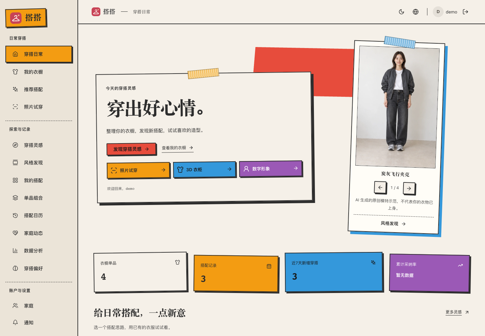
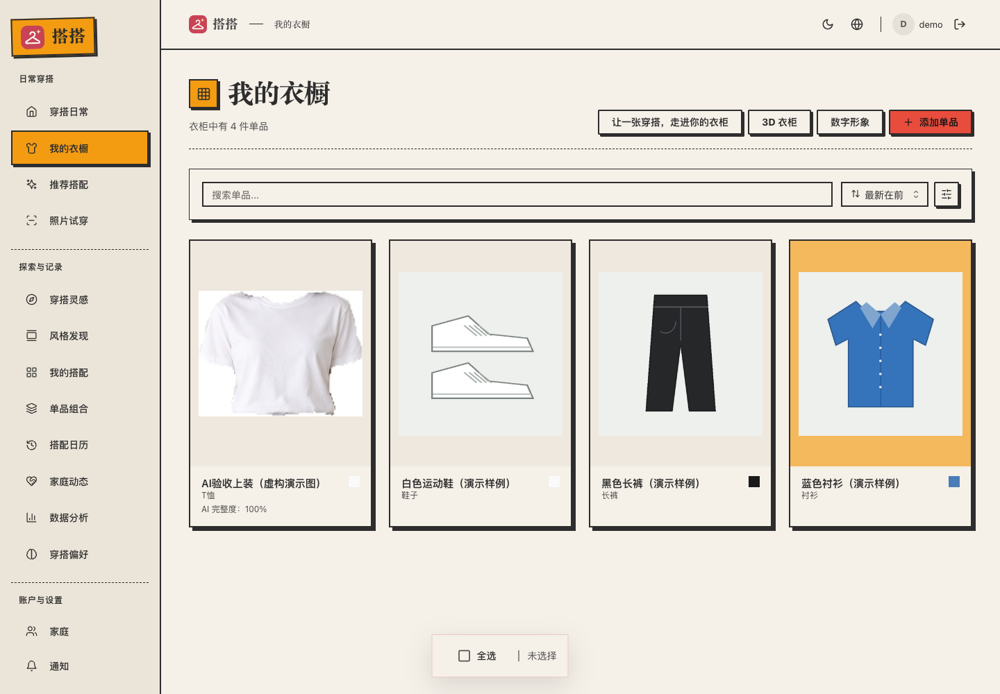
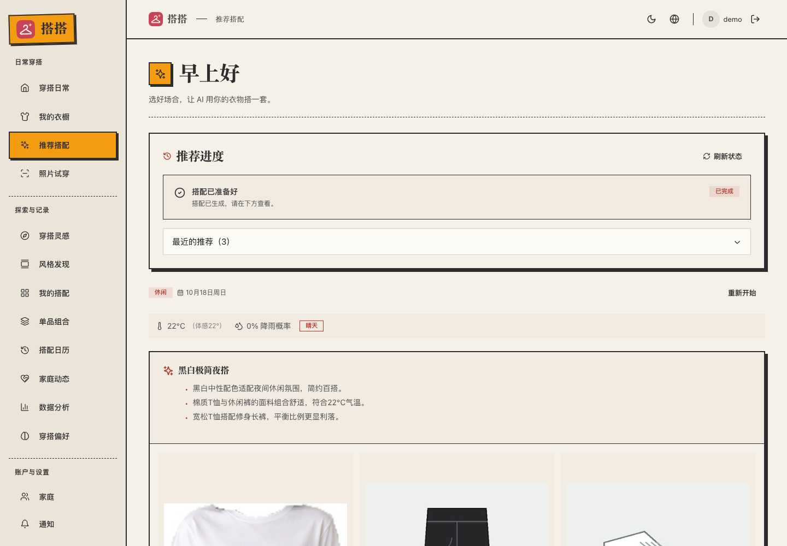
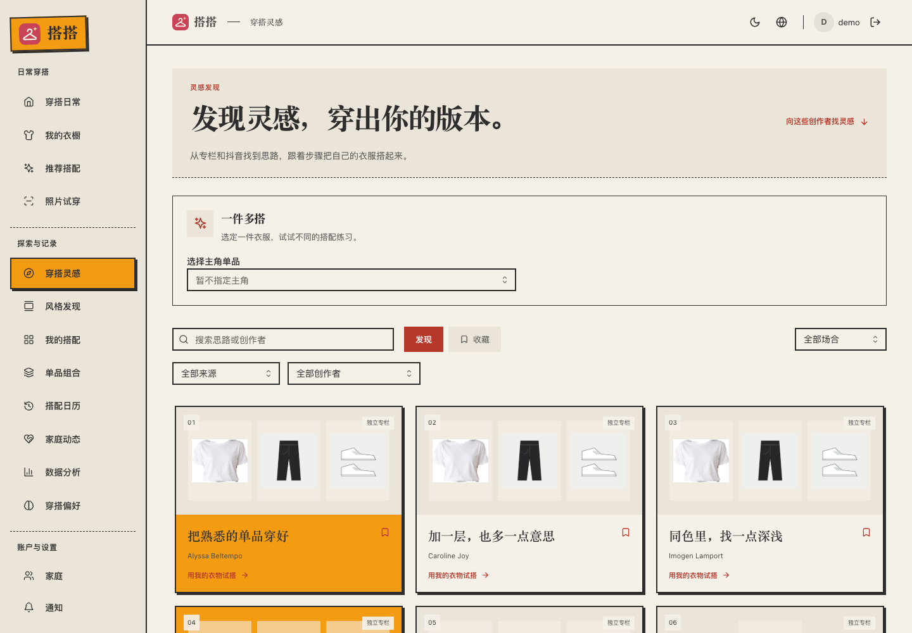
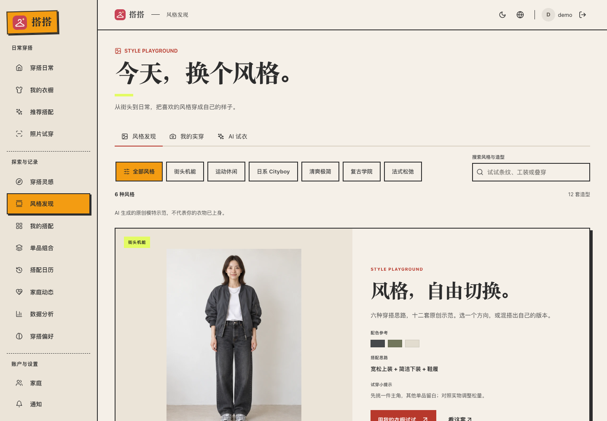
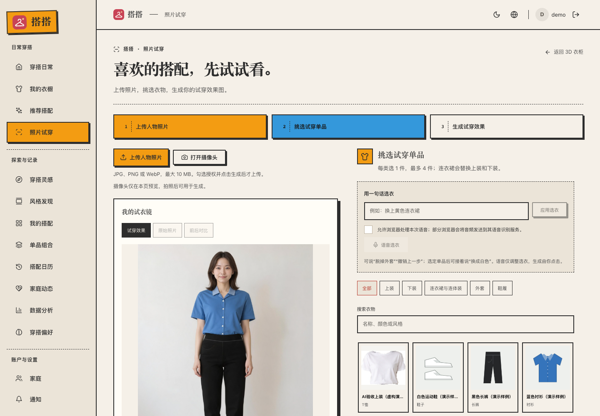
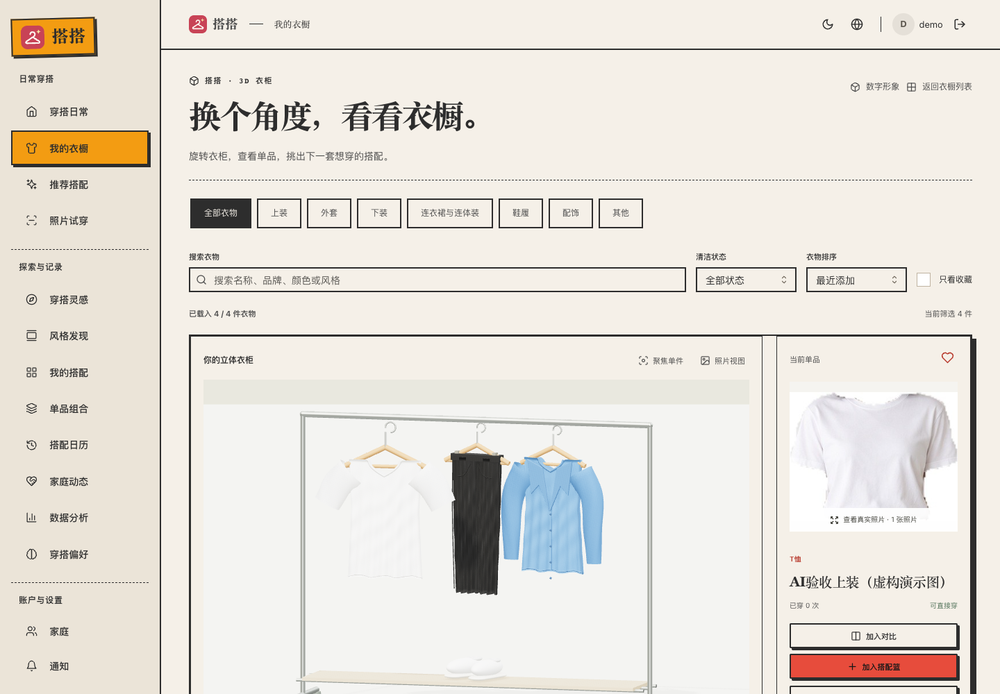
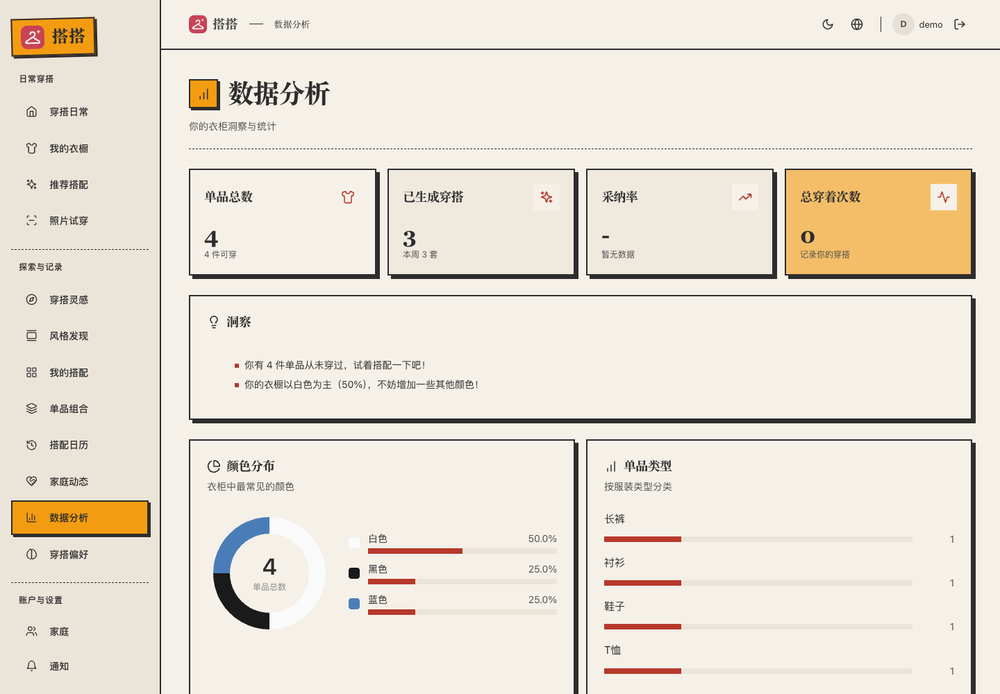
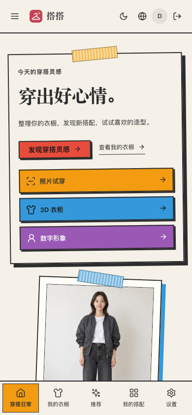

# 搭搭 · AI 衣橱与穿搭助手

云上码术队 · 京东 Aidol 创造营 S2 冒险季 · AI 应用

整理已有衣物，按天气和场合获得搭配建议，探索风格、试穿照片并查看预设三维造型。项目在比赛期间引入开源 [Wardrowbe](https://github.com/Anyesh/wardrowbe) 继续开发，保留上游 [MIT 许可证](LICENSE)。

## 作品体验与交付

当前 `main` 分支包含本地拼贴界面源码和后续部署、验收材料；`aidol-final-20261018` 标签及其发布附件保留原冻结快照，不随主分支更新。最新部署状态见 [服务器记录](ops/server-6780/README.md)。

| 项目 | 内容 |
|---|---|
| 产品地址 | [公网体验入口](https://124.70.96.183:6780/dashboard) |
| 体验方式 | 公开演示，无需输入账号密码，自动进入独立演示账号；访客共用演示数据，详见[体验说明](docs/submission/README.md) |
| 运行环境 | 公网 Ubuntu 24.04 x86_64、Node.js 22、Python 3.12；桌面 Chrome / Edge；本机 macOS + Docker Desktop |
| 可访问期限 | 队长已确认服务器与云桥模型额度保障至 **2026-11-10**；服务开机启动并异常自动重启 |
| 公开仓库 | [2892480843/AIdol](https://github.com/2892480843/AIdol) |
| 冻结版本 | `aidol-final-20261018`；完整提交号、源码包、演示视频与校验值见[同名 Release](https://github.com/2892480843/AIdol/releases/tag/aidol-final-20261018) |
| 从源码启动 | [运行说明](docs/submission/RUNNING.md)；既有本机发布记录见 [LOCAL-DEPLOYMENT.md](LOCAL-DEPLOYMENT.md) |
| 成果认定 | [赛前状态与48小时新增](docs/submission/BASELINE-AND-CHANGES.md) |

公网入口已启用可信 HTTPS，自动进入演示账号；摄像头和麦克风仍须浏览器授权，未将硬件权限检查当作实际设备效果验收。专用演示数据是合成衣物，不包含本机私人数据库。完整提交资料索引见 [docs/submission/README.md](docs/submission/README.md)。

## 当前界面

以下图片于 **2026-10-19** 从当前公网演示版实拍，点击图片可查看原图。

### 穿搭日常



### 衣橱与推荐搭配

| 我的衣橱 | 已完成的推荐搭配 |
|---|---|
|  |  |

### 穿搭灵感与风格发现

| 穿搭灵感 | 风格发现 |
|---|---|
|  |  |

### 照片试穿与三维衣柜

| 照片试穿 | 三维衣柜 |
|---|---|
|  |  |

### 衣橱数据



### 手机端



## 模型、API 与开源组件

- 衣物识别：`Qwen3.8-max`；穿搭推荐：`Doubao-Seed-2.0-Mini`；照片试穿：`Doubao-Seedream-5.0-lite`。
- 当前云端接口：`https://aistore.gsiig.cn/v1`，采用 OpenAI 兼容 API（同类模型请求格式），依赖网络和额度；真实密钥不随源码交付。
- 服务器本地模型：SCHP ATR18 INT8 ONNX 进行衣物可见区域提取，u2net / rembg 进行去背景，不在请求期间下载权重。
- 主要组件：Next.js / React / TypeScript / Mantine（网页）、Three.js（三维）、FastAPI（后端）、PostgreSQL / SQLAlchemy（数据）、Redis / ARQ（任务）、可选 RustFS / S3（对象存储）与 OpenTelemetry（运行观测）。
- 完整版本、模型部署、来源与边界见[依赖清单](docs/submission/DEPENDENCIES.md)和[运行说明](docs/submission/RUNNING.md)。

## 赛前已有与48小时新增

**队长确认赛前团队成果为零。** 比赛期间引入 Wardrowbe，上游基础为 `cfbb5a9`；上游已经具备衣橱、识衣、推荐、家庭、统计、通知等能力，不计作团队原创。团队在其基础上完成搭搭品牌及界面、云桥适配、持久任务、私有存储与账号隔离改进、风格发现、一件多搭、三维衣柜与造型、照片试穿、衣物提取及公网交付集成。详见[逐项对照及可复现差异](docs/submission/BASELINE-AND-CHANGES.md)。

当前未提供组委会赛前存档回执；团队声明不等于主办方认证。预设三维人物不是用户本人照片重建，照片试穿是二维生成，衣物提取不补画遮挡部分。

## 本机运行与验证

请先按[运行说明](docs/submission/RUNNING.md)准备私有配置、构建镜像、初始化数据库及模型。已配置电脑可运行：

```bash
./local.sh up -d
./local.sh ps
curl -fsS http://localhost:18000/api/v1/health/ready
```

本机网页为 `http://localhost:3000`，开发演示邮箱可用 `demo@wardrowbe.local`；该邮箱不是公网入口认证账号。

验收记录见 [verification/submission](verification/submission/)、[公网部署](ops/server-6780/README.md)和[功能矩阵](verification/full-function/FEATURE-MATRIX.md)。历史报告仅反映记录时的版本；本次新检查与结果单独留存。材料准备与 GitHub 发布不代表组委会最终表单已提交，仍须以表单成功回执为准。

## 开源许可

本项目基于开源 Wardrowbe 继续开发，遵循 [MIT 许可证](LICENSE)。上游来源与团队新增范围见[成果对照](docs/submission/BASELINE-AND-CHANGES.md)。
