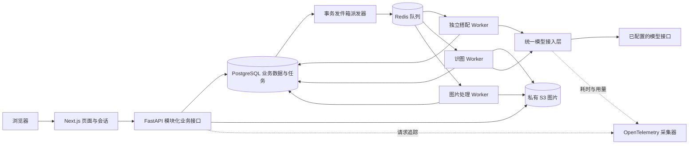

# Wardrowbe 产品架构

本文描述本机已实现的代码与运行职责。运行方法、备份和公开部署边界见 [本机部署说明](../LOCAL-DEPLOYMENT.md)，验证记录见 [架构验收报告](../verification/architecture/REPORT.md)。

## 组成与边界

| 层 | 实现 | 选择原因 |
|---|---|---|
| 页面 | Next.js、React、TypeScript | 页面、会话和同源接口转发集中维护 |
| 业务 | FastAPI 模块化单体 | 领域模块明确分工，保留单库事务，避免当前规模不需要的分布式服务复杂度 |
| 状态 | PostgreSQL | 保存业务结果、任务状态、投递意图；队列故障不丢已提交的任务 |
| 执行 | Redis + ARQ，独立 Worker | 模型调用不占用网页请求，推荐任务可单独扩容 |
| 图片 | 文件系统/S3 适配器，当前启用私有 RustFS | 路径和签名接口保持兼容；迁移前后可按字节校验 |
| 模型 | `model_gateway.py` | 统一接口兼容、重试、语言约束、用量记录与敏感内容过滤 |
| 观测 | OpenTelemetry | 关联请求、任务和模型调用，定位错误与耗时 |

## 推荐任务的一致性

1. 接口验证用户身份和请求，使用幂等键避免同一次请求重复创建任务。
2. 同一次数据库提交保存 `durable_tasks` 和 `task_outbox`。这就是事务发件箱：把“之后需要投递任务”的意图与业务记录一起落库。
3. 派发器通过数据库锁认领记录，再向独立推荐队列投递；失败保留意图并延迟重试。
4. Worker 使用代次、执行令牌、租约和数据库锁，防止重复投递或过期执行重复保存结果。
5. 全部搭配和任务完成状态一起提交。取消或中途失败会撤销本次未完成结果。
6. 前端查询服务器状态，刷新或离开页面不影响任务；完成后用现有搭配详情接口读取结果。

心跳间隔 10 秒，租约 45 秒，单次执行时限 180 秒，最多自动执行 3 次。取消立即落库；正在等待的协程在下一次心跳观察后停止。服务商已经接收的模型调用是否停止取决于服务商。

业务结果保证不因重复投递重复提交；**外部模型请求不能保证只调用一次**，崩溃恢复可能再次计费。现有同步推荐接口仍保留兼容，重构后的页面走持久任务接口。

## 识图与图片处理

上传和重新分析在提交衣物状态时，一并写入 `tagging_outbox`。接口提交后仅尝试有时限的即时投递；Redis 不可用时仍能返回已保存的衣物，派发器恢复后继续投递。

识图按衣物和任务代次防重，写回前再次检查状态。用户人工完成分类会使旧任务失效，旧模型结果不会覆盖人工分类。丢失队列消息可重放；ARQ 已完成但业务仍待处理时，使用新代次绕开保留的旧队列结果。

旋转、去背景等原有图片变更使用独立图片 Worker，保留原有手动重试语义；这类操作没有宣称具备与推荐/识图相同的自动恢复保证。

图片经存储适配器读写，后端签名接口对外提供内容。桶保持私有；处理算法需要本地路径时，使用有生命周期的临时文件。迁移保留原文件，拒绝覆盖不同内容，支持重复运行并核对 SHA256。数据库和对象存储之间没有分布式事务；接口失败时存在遗留对象的可能，恢复和清理必须按数据库引用与备份清单核对，不能盲目删除。

## 前端职责

推荐功能按表单、天气、基础单品、任务面板、结果和数据 hooks 拆分。任务状态来自后端；页面只负责交互和轮询。

- 查询缓存和批量操作按后台用户身份绑定，账号切换会取消旧请求并清理旧缓存。
- 上传队列保留文件归属，切换账号后中止发送；未知归属的历史文件要求逐个确认。
- 工作室草稿按用户保存；失效会话给出明确的重新登录入口。
- 任务错误码转换成当前语言的提示；类型与多语言校验纳入构建验收。

## 运行与演进

当前是单机 Docker Compose 的十服务部署。后端和前端使用项目自己的镜像，数据库迁移单独执行，私密配置保存在忽略提交的本地环境文件。备份脚本短暂停止写入者，导出数据库和全部图片，保存校验清单后恢复服务。

公开发布还需正式身份服务、域名/HTTPS，以及实际使用的通知渠道。当前本机对象存储、数据库和 Redis 均为单节点，尚未进行高可用和容量压测。后续是否引入托管数据库、异地备份或多节点存储，应由公开部署规模和恢复目标决定。
