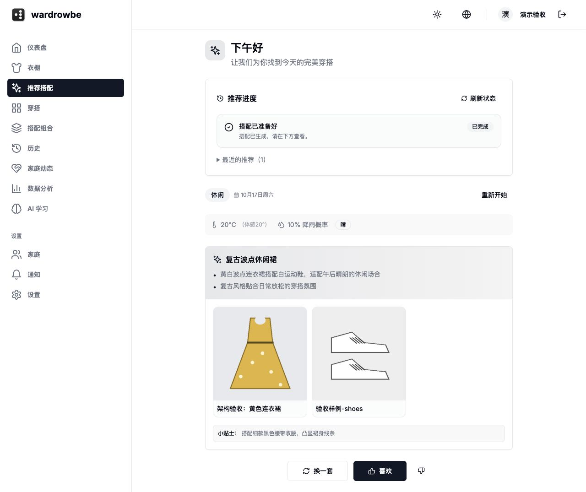

# 架构与前端重构验收

验收日期：2026-10-17。环境：已确认的 macOS Apple Silicon（`Darwin arm64`）与 Docker Desktop。

**已完成本机架构落地和前端模块重构，十个服务正常运行；最终后端 2151 项、前端 730 项测试通过，失败与跳过均为 0。**

应用：[http://localhost:3000](http://localhost:3000)。本次没有发布到公网。

## 交付范围

| 部分 | 已实现 |
|---|---|
| 后端 | FastAPI 模块化业务接口，兼容现有衣橱、搭配和图片签名接口 |
| 推荐任务 | PostgreSQL 保存任务、状态与投递意图；独立派发器和推荐 Worker，支持刷新恢复、取消、重试、幂等与中断恢复 |
| 识图任务 | 衣物与投递意图同事务保存；队列停机仍可上传，恢复自动投递；任务代次与人工分类保护 |
| 存储 | 文件系统/S3 适配器，当前使用私有 RustFS；原文件保留，迁移逐个校验 SHA256 |
| 模型接入 | 统一接口兼容、有限重试、语言约束、模型/提示词版本记录、敏感日志过滤 |
| 监测 | OpenTelemetry 请求和模型调用追踪、任务关联、耗时与用量指标，真实 Collector 接收验证 |
| 前端 | 推荐表单、天气、基础单品、任务面板、结果与数据 hooks 拆分；账号缓存、批量操作、离线上传与草稿隔离 |
| 运行 | 项目自己的后端/前端镜像、数据库增量迁移、私密环境文件、数据库和图片一致性备份脚本 |

事务发件箱是“把之后需要投递任务的意图与业务记录一起保存”的机制；队列故障不会让已保存的业务任务失去投递依据。重复投递不会重复提交推荐结果；外部模型调用仍可能因故障恢复而重复发生。

架构图及一致性说明见 [ARCHITECTURE.md](../../docs/ARCHITECTURE.md)，构建、启停和恢复方法见 [LOCAL-DEPLOYMENT.md](../../LOCAL-DEPLOYMENT.md)。

## 自动化与构建

| 验证 | 最终结果 | 证据 |
|---|---|---|
| 后端全套 | 2151 通过，0 失败/错误/跳过 | [JUnit](backend-tests-final.xml)、`backend-tests-final.log` |
| 前端全套 | 730 通过，0 失败/跳过 | [测试结果](frontend-tests-final.json) |
| TypeScript | `npx tsc --noEmit` 返回 0 | [执行记录](frontend-verification-final.json) |
| 八语言检查 | `npm run i18n:check` 返回 0 | 同上 |
| 前端生产构建 | `npm run build` 返回 0，未跳过类型与 lint 门禁 | 同上、`frontend-docker-build.log` |
| 后端镜像与静态检查 | 自有镜像构建、相关 Ruff、Compose 配置、Shell 语法、差异检查通过 | `backend-build-final.log`、`backend-lint.log` |
| 运行身份 | 6 个应用进程均使用最终自有镜像；157 个后端源文件与运行容器逐一比对一致 | [镜像与源码](deployment-images.json)、[源码摘要](source-checksums.json) |
| 私密配置检查 | 6 个已配置凭证在可审阅文件中的原值匹配为 0 | [扫描记录](secret-scan.json) |

测试中保留上游弃用及既有 lint 警告。一轮并行验证曾因主动停止共享 Redis 实例干扰 9 项通知测试，日志保留为 `backend-tests-redis-interference.*`；停止故障注入后，最终完整重跑 2151 项全部通过，未为消除这类干扰修改业务代码。

## 真实运行验证

全部使用合成衣物与隔离测试账号，实际经过前端转发、后端、数据库、队列、私有图片存储与已配置的真实模型接口。

| 场景 | 观察结果 | 证据 |
|---|---|---|
| 核心功能 | 集成过程中 17 组功能通过：识图、签名图片、编辑/检索/归档、穿洗记录、旋转、去背景/恢复、偏好、手动与 AI 搭配、反馈、家庭、统计、天气、本地通知接收 | [核心流程](live-core.json) |
| 推荐任务 | 真实中文三套生成、同幂等键复用、刷新读取、用户隔离、取消终态、失败后重试均通过 | [任务流程](live-tasks.json) |
| 强杀 Worker | `SIGKILL` 中断第一次执行，自动恢复到第二次并成功；只保存 1 套业务结果 | 同上 |
| 数据一致性 | 验收账号只有原三套加恢复后一套，共 4 套，无重复或取消结果；提示词/模型接入层版本及原请求 ID 已持久化 | [数据库审计](runtime-audit.json) |
| Redis 停机上传 | 1.44 秒返回成功；数据库保存待投递记录，恢复后约 21.72 秒完成绿色 T 恤中文识图，签名图片可读 | [停机识图](live-tagging-outage.json) |
| Redis 停机批量取消 | 两张图片批传成功，取消耗时 1.03 秒；恢复后投递意图结束，继续观察 20 秒无 AI 写回或新任务代次 | [停机取消](live-bulk-cancel-outage.json) |
| 最终浏览器完整流程 | 上传黄色连衣裙 → 中文识图 → 生成“复古波点休闲裙”搭配；图片加载正常，浏览器错误/警告记录为空 | [上传](browser-upload-ai.json)、[最终结果](browser-final.json) |
| 刷新与移动端 | 生成过程中刷新仍显示服务器任务进度；390×844 视口无横向溢出，之后恢复正常视口；七个页面无错误边界 | [页面](browser-pages.json)、[刷新截图](browser-progress-restored.png)、[手机截图](browser-mobile.png) |
| 监测导出 | Collector 实际收到请求/模型追踪、耗时、用量和任务关联数据 | [接收记录](otel-receipt.json)、`otel-collector.log` |

最终浏览器单套推荐实测约 69.71 秒；模型服务响应时间有波动，此结果不是容量或延迟承诺。识图完整度与模型置信度不等于经人工标注测得的识别准确率。



## 数据迁移、备份与恢复

- 原有 48 个图片文件已复制到私有对象存储，并逐一按 SHA256 核对；原文件卷保留。
- 数据库先在独立备份副本迁移到 `f0a3b4c5d6e7`，原记录数量保持一致，之后才升级运行实例。见 [迁移记录](migration-final.json)。
- 最终一致性备份位于本机 `backups/20261017-151508-gDLaX6`：数据库快照和 **87 个校验通过的图片对象**，脚本完成后写入服务已恢复。
- 快照已恢复到独立数据库 `wardrobe_arch_backup_1515`。用户 14、衣物 29、搭配 45、推荐任务 6、识图投递记录 4，和备份时运行库数量一致，迁移版本为 `f0a3b4c5d6e7`。见 [恢复记录](restore-final.json)。
- 新增图片写入 S3，因此仅切回旧本地文件卷不足以完成回滚；需要依据数据库和完整图片备份清单恢复。

## 验证边界

当前交付是本机可运行的软件。正式公开部署的 OIDC 身份服务（统一登录）、域名/HTTPS、真实邮件/手机推送渠道尚未配置。本机对象存储、数据库与 Redis 均为单节点，未进行高可用及容量压测；Collector 已接收数据，长期监测存储和告警平台尚未接入。

旋转、去背景保留原图片队列与手动重试语义，不宣称与推荐/识图相同的自动恢复保证。数据库与图片存储没有分布式事务；异常中断可能留下无引用图片，清理时需要核对数据库引用和备份清单。

模型真实调用与确定性约束测试已通过，尚未进行大规模真实衣物识别准确率或风格满意度测评。

## 复验入口

```sh
./local.sh ps
curl -fsS http://localhost:18000/api/v1/health/ready
python3 verification/architecture/collect_evidence.py
```

全套测试使用隔离数据库与 Redis 逻辑库；执行真实停机故障脚本时必须错开使用同一 Redis 实例的测试。验收汇总为 [SUMMARY.json](SUMMARY.json)。
